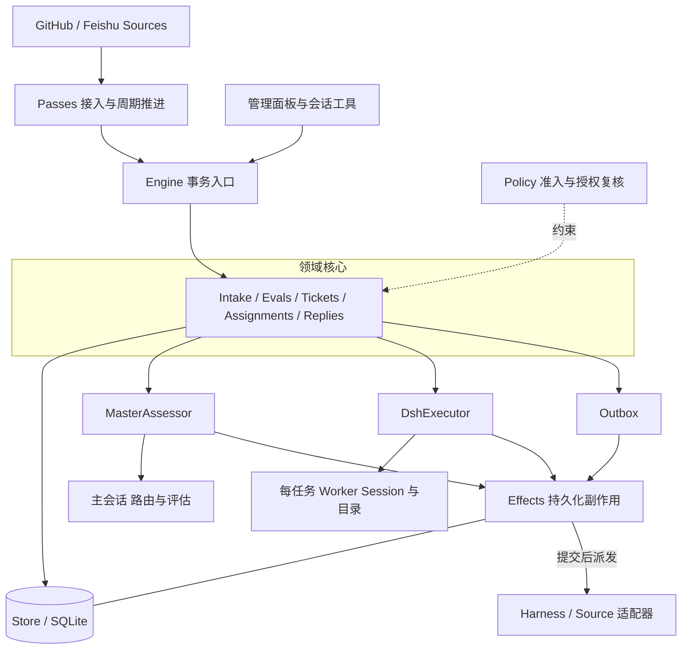
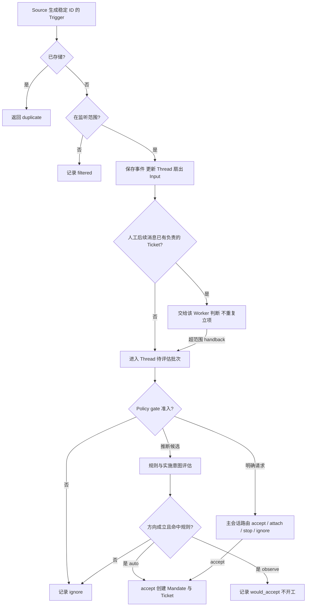
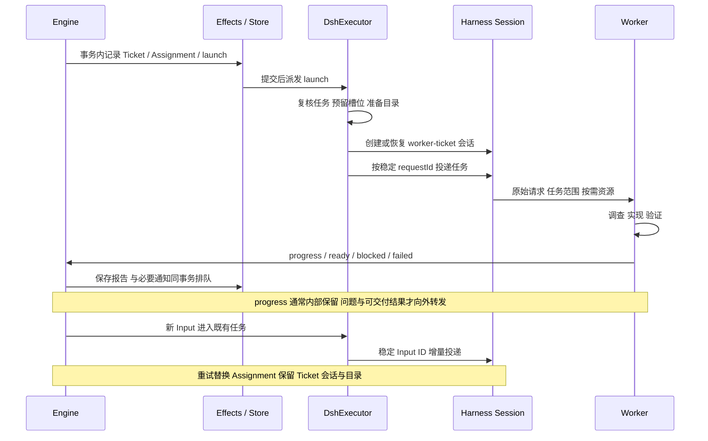
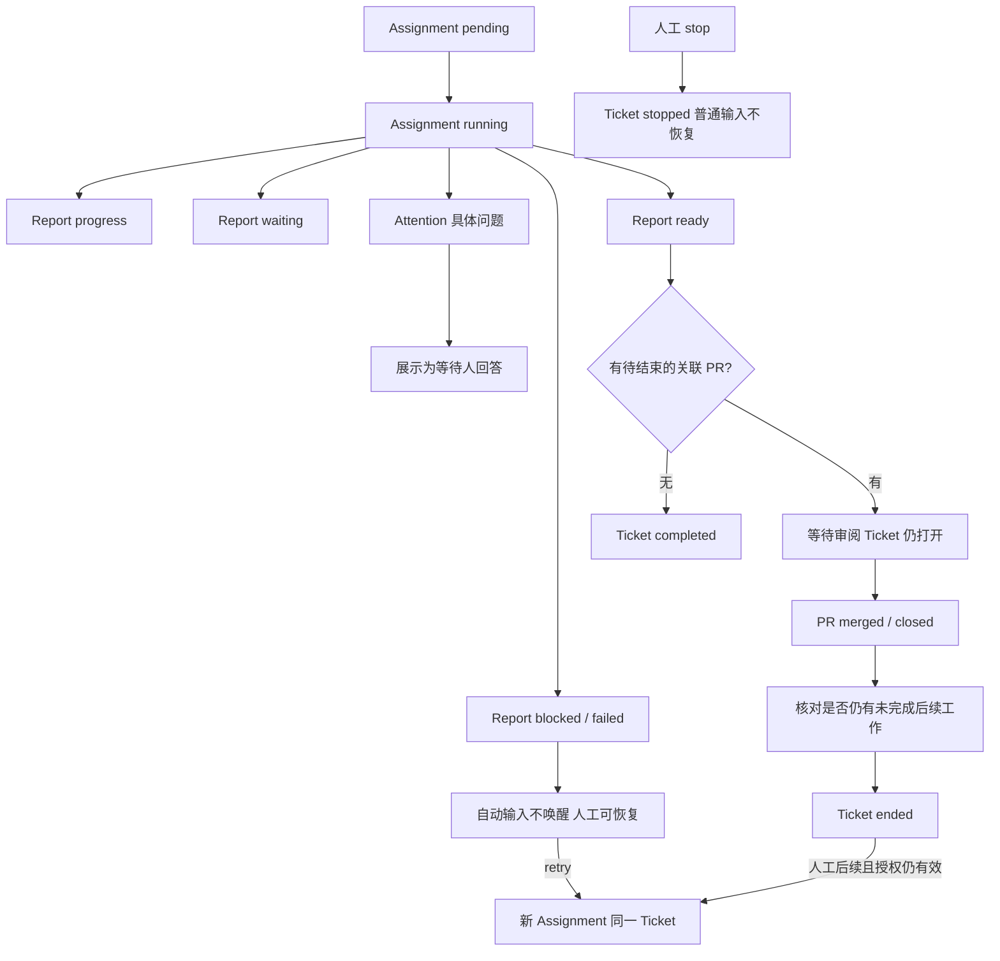
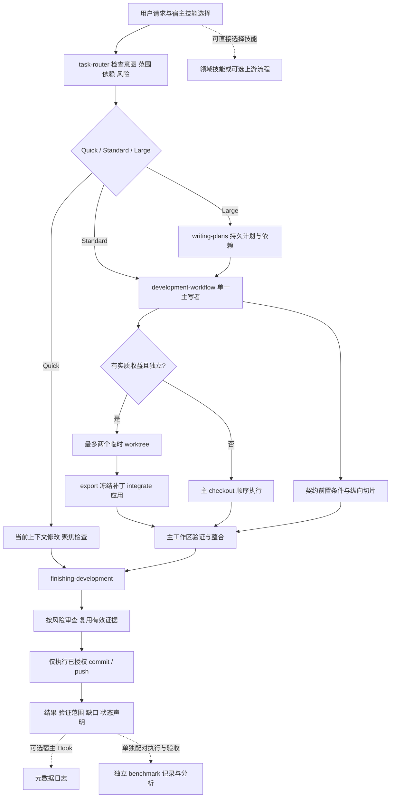

# DeepSeek SuperAgent 执行机制与 RelayForge 工作流对照分析

分析日期：2026 年 11 月 6 日。对象：DeepSeek 公开研究原型 `dsh-superagent-prototype` 与当前 RelayForge Development 插件。本文交付执行逻辑、核心实现定位、工作流、架构图和问题清单；不实施工作流或代码改造。

**结论：SuperAgent 最值得借鉴的是任务生命周期的确定性管理。** 它将模型判断与程序控制分开，用不可变授权、任务与执行尝试分离、消息归属、持久化副作用和恢复核对，支撑持续运行。RelayForge 已有按需路由、风险分级、证据复用和有界协作；主要不足是这些约定尚未形成统一的跨会话执行协议。另有两项辅助脚本问题已在临时仓库复现，应先于扩展多代理能力处理。

## 1 分析基线与证据边界

| 项目 | 固定基线 | 本次核对范围 |
| --- | --- | --- |
| SuperAgent | 提交 `8c32a9dc5d72c033816c6a8110b37f40cf94fba4`；包版本 `0.1.0` | 下载公开源码归档；静态阅读核心、运行时、执行器、策略、消息适配器和相关测试 |
| RelayForge | 提交 `fe1e03cb2c979d4b2056c1cbe253b4e7efbef501`；分支 `relayforge/fix/quality-and-cost`；插件版本 `0.1.9` | 阅读核心技能、交接与并行协议、辅助脚本、日志和评估实现；运行现有测试与两项隔离探针 |

SuperAgent 上游将其定位为研究原型，明确公开代码与内部版本、设计文章存在差异。以下执行结论以本次源码快照为准，不将文章中的未来方向当成已实现能力。[S01]

证据分为三类：**源码事实**表示可定位到实现；**已复现问题**表示在临时测试仓库实际触发；**协议缺口或设计风险**表示现有约定不足以保证某种行为，不代表已经发生用户事故。SuperAgent 未进行依赖安装、服务部署或上游测试执行；上游测试仅用于核对设计覆盖面。

## 2 两个项目分别解决什么问题

SuperAgent 是运行在 DeepSeek Harness 中的常驻编排应用。它围绕一个 GitHub 仓库接收事件，按授权决定是否创建任务，维护多个持久会话，并把结果送回原对话。Harness 提供模型调用、工具、会话、事件和持久化等基础设施。[S01][S14]

RelayForge 是跨宿主的开发工作流插件。技能指导当前代理选择方法、实现、验证和收尾；Python 脚本为分支、临时 worktree、审查快照和日志提供局部确定性检查。它没有提供与 SuperAgent 等价的常驻调度器。[L01][L02]

| 维度 | SuperAgent | RelayForge | 比较时的判断 |
| --- | --- | --- | --- |
| 工作入口 | GitHub、可选飞书、管理面板 | 用户当前对话和宿主技能选择 | 入口不同属于定位差异 |
| 执行驱动 | 事件、周期 pass、持久化队列 | 当前代理按技能继续执行 | 不应仅因缺少后台循环判定插件有缺陷 |
| 持续状态 | SQLite 中的任务、输入、执行尝试、回执 | 对话、计划、局部 JSON manifest | 跨会话可靠性值得比较 |
| 授权执行 | 程序检查准入与任务状态，语义范围仍需模型遵守 | 宿主权限与工作流约定共同约束 | 提示词不能代替权限系统 |
| 并行 | 多 Ticket 的运行槽位管理 | 默认单写者，例外最多两个并行写者 | 并行数量不是质量指标 |
| 依赖协调 | 核心侧重消息与任务归属 | 显式前置任务、契约和纵向切片 | 现有依赖约束应保留 |

## 3 SuperAgent 的核心领域对象

理解源码应先区分“发生了什么”“允许做什么”和“本次由谁执行”。这些对象分别承担不同职责。[S02]

| 对象 | 含义 | 最重要的约束 |
| --- | --- | --- |
| Source | 某类事件的来源及其配置 | 负责监听范围、读取位置和来源身份 |
| Trigger | 一次不可变的输入事件 | 稳定 ID 用于去重；正文和元数据是外部数据 |
| Thread | 同一讨论范围 | 同时最多一个 Eval；可以关联多个任务 |
| Eval | 对待处理事件批次的一次评估 | 先确定性准入，再进行必要的模型判断 |
| Decision | 本次评估的记录 | 接受、忽略、停止、不可用等结论可追溯 |
| Mandate | 一次接受产生的授权记录 | 保存来源、请求人、范围、强度及策略版本；范围扩大需要新任务 |
| Ticket | 一件获得授权的工作 | 持有输入、讨论关联和执行历史；生命周期不等于会话状态 |
| Assignment | Ticket 的一次执行绑定 | 同一 Ticket 可以先后有多次 Assignment |
| Subscription | Ticket 对 Thread 的订阅关系 | 传递上下文；订阅本身不授予新权限 |
| Input | 交给执行器的增量信息 | 区分未投递、已投递和会话已读取 |
| Report 与 Attention | 执行状态和需要人的具体问题 | 等待人由结构化字段表示，不从自由文本猜测 |
| Effect 与 Receipt | 待执行副作用与发送回执 | 支持重试、去重、排序和重启后续办 |

最关键的两个区分是：**Ticket 不等于 Assignment；上下文不等于授权。** 重试不需要把原目标变成新任务，收到相关评论也不代表可以扩大工作范围。

## 4 SuperAgent 总体架构



`Runtime` 是装配入口，负责目录锁、Store、策略、会话、执行器、SourceRegistry、Effects 和 HTTP 的生命周期。`Engine` 是领域修改入口，内部五个部件处理业务状态。两者职责不同：Runtime 负责“接好并运行”，Engine 负责“状态允许怎样变化”。[S03][S04]

图中省略反向回调以便阅读：主会话的路由决策、Worker 报告及执行器生命周期事件都回到 Engine；发送适配器把消息送回原 Source 的对话。

主会话并非无限大的技术指挥中心。提示词要求它评估和路由；Worker 读取原始请求、调查、实施和验证。程序限制工具和等待行为，但“不要替 Worker 做技术方案”仍主要由提示词约束。[S15]

## 5 最核心实现的阅读地图

| 优先级 | 文件与入口 | 需要理解的实现 |
| --- | --- | --- |
| 第一组 | `src/core/model.ts`、`engine.ts`、`ports.ts` | 对象、不变量、事务入口、外部依赖接口 |
| 第一组 | `src/core/intake.ts` 的 `receive` | 去重、来源过滤、订阅扇出、后续消息归属 |
| 第一组 | `src/core/evals.ts` 的 `start`、`decide`、`accept` | 批次、策略版本、重复接受防护、创建 Mandate 与 Ticket |
| 第一组 | `src/core/tickets.ts` 的 `create`、`wake`、`retry`、`end` | 任务与执行尝试分离、续接、停止和未处理消息释放 |
| 第二组 | `src/policy.ts` 的 `settingsPolicy`、`assessmentOutcome` | 谁可发起工作；推断请求何时可以转成实际任务 |
| 第二组 | `src/app/store.ts` 的 `atomic`、`afterCommit` | SQLite 保存点、回滚、提交后内存回调 |
| 第二组 | `src/app/effects.ts` 的 `enqueue`、`attempt` | 持久化副作用、generation、防止旧执行覆盖新任务 |
| 第二组 | `src/executor/dsh.ts` 的 `launchQueued`、`deliverQueued`、`resume` | 槽位、会话、目录、增量输入、重试与恢复 |
| 第三组 | `src/core/assignments.ts`、`stage.ts`、`replies.ts` | 结构化报告、阶段派生、回复目的校验 |
| 第三组 | `src/app/delivery.ts`、`outbox.ts`、`sources/github-channel.ts` | 会话投递去重、发送回执、GitHub 评论标记 |
| 第三组 | `src/app/passes.ts`、`runtime.ts`、`sessions.ts` | 推进循环、启动恢复、工具限制、宿主事件衔接 |

这些模块共同构成核心；只读 Router 和 Worker 提示词，会漏掉可靠性机制。具体源码链接见文末 S02 至 S19。

## 6 从请求到任务的实际工作流

### 6.1 接入与去重

1. Source 将 Issue、评论、评审、CI 等输入转换为 Trigger，保留来源身份和回复位置。GitHub 评论 ID 包含评论版本信息，正文被编辑后可成为新事件。
2. `Engine.receive` 在事务内调用 `Intake.receive`。已存在的 Trigger 直接返回 `duplicate`。
3. 不在监听范围的事件被标记为过滤；其余事件更新 Thread 及其关联信息。
4. 向订阅这些 Thread 的 Ticket 追加 Input，并记录消息到达了哪些任务、是否仅供上下文。
5. 仍由某个 Worker 负责判断的人工后续消息留给该任务；其余事件进入主 Thread 的 Eval 队列。[S05][S16]



### 6.2 准入与语义判断分层

`Policy.gate` 根据 Source 身份、允许名单、是否直接请求、接收范围及策略表，决定事件是否准入和请求强度。模型不能通过一段评论修改名单或把机器人身份变成人。[S06]

明确请求走路由入口，支持接受新任务、附加到已存在任务、停止和忽略。推断请求需要评估规则与意图：实现目标是否成立、是否已有明确方向、是否仍需要设计决策，以及是否命中启用规则。[S06][S17]

`off / observe / auto` 控制的是推断工作。默认 `observe` 会记录本来准备接受的任务，而不创建实际 Ticket；明确请求不依赖自动接受模式。`observe` 会消耗评估成本，不是完全不运行模型。[S06]

### 6.3 接受是一组原子状态变化

`Evals.accept` 从本次评估构造 Mandate，生成 Ticket ID，记录 Decision，调用 `Tickets.create` 建立输入与订阅、初次 Assignment，并排队启动和必要的确认消息。外层事务使领域记录整体成功或整体回滚。[S03][S07] 评估侧的具体实现见 [Evals.accept](https://github.com/deepseek-ai/dsh-superagent-prototype/blob/8c32a9dc5d72c033816c6a8110b37f40cf94fba4/src/core/evals.ts#L306)。

同一 Trigger 已接受时返回既有 Decision；评估结果还必须属于有效的 Eval 和策略版本。这避免事件重放、迟到的模型结果或评估期间策略变化导致重复立项。

## 7 执行器怎样持续推进任务



### 7.1 一个任务保留一个工作上下文

`DshExecutor` 使用 `worker-<ticketId>` 作为持久会话 ID，以任务短名和 ID 后缀生成目录。配置的 prepare 命令可以创建 Git worktree；如果未配置，默认只是创建工作目录。因此“每 Ticket 一个目录”不能直接等同于“内置 Git 隔离”或“每次重试创建新 worktree”。[S08]

首次投递包含原始事件和任务信息；后续 Assignment 尽量只交付新增信息。长文本提供预览与资源读取位置，避免持续复制整个历史。[S08][S09]

### 7.2 并发围绕运行槽位

槽位统计包含启动中、运行中和回合结束后仍在运行的后台工作。人工后续输入可使用一个额外槽位，避免新任务占满容量后阻塞人对旧任务的继续处理。它不是任意增加并发的通道。[S08]

Worker 回合结束但后台命令或子代理尚在运行时，不能立刻报告任务在等待。执行器追踪这些工作；普通后台收尾有上限。向人交接时释放槽位，停止子代理，部分供人检查的服务进程可继续保留，直至 Assignment 结束。[S08]

### 7.3 结构化报告决定交接

报告包括 `progress / waiting / ready / blocked / failed / dropped`，另有具体问题字段。代码拒绝同时“ready”与“提出问题”等不一致组合。普通 progress 通常不向主会话转发；需要人回答、结果或失败才走相应通知。[S10][S11]

但 `ready` 的技术质量并未由状态机自动证明。实现是否符合需求、测试是否充分，仍依赖 Worker、审查和项目检查。结构化状态阻止部分逻辑矛盾，不能代替验收。

## 8 状态不是一个枚举

SuperAgent 同时管理任务结局、执行绑定、报告和展示阶段。混为一个 `done` 会使恢复逻辑失真。[S02][S10]



| 状态层 | 示例 | 语义 |
| --- | --- | --- |
| Assignment | pending、running、ended | 本次执行绑定是否开始或结束 |
| Report | progress、waiting、ready、blocked、failed、dropped | 执行器最近报告了什么 |
| Ticket outcome | completed、merged、closed、dropped、stopped | 整件任务如何结束 |
| 展示阶段 | working、queued、idle、person、ended | 当前主要在等待谁或什么 |

`ticketStage` 按优先级派生展示阶段：已结束、输入交付失败、人工问题、待审阅、阻塞或失败、排队、空闲、工作中。它不是要求模型再维护一份随时可能矛盾的独立状态。[阶段派生实现](https://github.com/deepseek-ai/dsh-superagent-prototype/blob/8c32a9dc5d72c033816c6a8110b37f40cf94fba4/src/core/stage.ts#L9)

`ready` 且有关联开放 PR 时通常意味着等待审阅；PR 关闭或合并后，还要检查是否存在尚未完成的后续工作。没有关联 PR 的 ready 可以直接完成任务。**打开 PR、本轮执行结束、可以审阅和任务最终结束是不同事实。**[S07][S10]

## 9 可靠性最关键的五个实现

### 9.1 先记录副作用 再执行副作用

Engine 的同步命令在事务内修改任务并写入待办 Effect；真正启动会话、投递输入或发送消息在事务提交后发生。领域记录回滚时，对应待办也回滚。[S03][S12]

`Effects` 以 kind 与 key 合并待办，保留排序位置，用 generation 区分新旧内容。执行期间若出现新版待办，旧尝试结束时不能删除新版记录。它解决的不只是失败后重试，还有“执行期间收到更新”的竞态。[S12]

`Store.afterCommit` 用于不要求跨重启保留的内存动作；要求恢复后继续执行的动作进入持久化 Effects。两者不能互相替代。[S13]

### 9.2 投递成功与模型读取分开

`AgentDelivery` 从持久会话历史、内存事件和收件箱判断同一 requestId 是否已投递，并在回执前刷新会话持久化。Ticket 的输入还记录 `readAt` 与 `deliveredTo`，恢复时把已投递但未读的消息重新排队，并去除收件箱里可能残留的副本。[S09][S10]

这避免“消息已经排入队列”被误认为“模型已经处理完”。它仍不能证明模型真正理解或执行了每条输入。

### 9.3 不重复处理人工后续消息

订阅线程的人工后续默认留给已有 Worker。主会话收到提示，但除人工要求停止外不能再次替它路由；Worker 认为超范围时 handback，待没有其他任务仍拥有该消息后，才进入新评估。仅供上下文的订阅不建立这类所有权。[S02][S05][S07]

这比“每条新评论都让 Router 再想一次”更能避免重复开工。按主题相似度猜测归属仍可能错误，因此提示词要求附加任务时依据明确引用，而不是仅凭话题相似。[S15]

### 9.4 重试按失败类型处理

| 失败或等待 | 处理方式 | 不应误读为 |
| --- | --- | --- |
| Eval 超时 | 从候选投递后计时；允许两次重排，第三次过期记不可用 | 排队时间也算模型评估超时 |
| 暂时网络或模型供应商错误 | 有限次重试并退避 | 业务错误也自动反复重做 |
| prepare 命令失败 | 报失败，保留非空残留目录，等待人工输入或 retry | 自动重跑一切初始化命令 |
| 输入或通知 Effect 失败 | 持久队列退避重试 | 连续三次失败就必定停止重试 |
| Effect 同类累计失败 | 达阈值后在健康状态中暴露 | 健康告警阈值等于重试次数上限 |
| blocked 或 failed | 自动输入不继续唤醒；人工输入或 retry 可解除等待 | 所有工具都锁死，人工也不能继续 |
| 处理暂停 | 暂缓新派发、相关交付与发送，评估期限相应移动 | 立即终止所有已运行程序 |
| 人工停止 Ticket | 结束执行，普通后续输入不恢复该 Ticket | 与暂停处理或暂时失败相同 |

上述区分分别由 Evals、Effects、Tickets 和 DshExecutor 实现；不能把它们简化成一个“最多重试三次”的总规则。[S06][S07][S08][S12]

### 9.5 恢复要先核对现实世界

启动时，执行器区分运行中断、已有稳定报告和待启动 Assignment。需要恢复的任务保留 Ticket、目录与会话，并收到明确提示：先检查工作区、Git 历史和 GitHub 状态，避免重复已完成的外部操作。[S08][S10]

内部队列可实现按键去重；GitHub 评论通过正文中的稳定标记减轻“远端已发送、本地未记回执”的重复。任意 shell 命令、提交、PR 创建和远端系统不因此获得通用的 exactly-once 保证。[S18][S19]

## 10 哪些由代码保证 哪些仍依赖模型

| 事项 | 实现方式 | 能力边界 |
| --- | --- | --- |
| 身份与准入 | Policy、Source 元数据、参数校验 | 依赖适配器正确识别来源 |
| 策略版本与恢复授权 | Mandate、版本检查、revalidate | 活跃任务收到策略变化，不等于立即全部取消 |
| 任务结束后工具不可继续使用 | Session 工具 guard | 不是操作系统级沙箱 |
| 稳定输入与任务去重 | Trigger ID、Decision、AgentDelivery | 不保证模型判断始终正确 |
| 事务和待办队列 | Store、Effects、Outbox | 不自动回滚已经发生的远端行为 |
| 合理实施范围与充分验证 | 任务提示词、仓库规则、Worker 判断 | 不能仅凭 Report 宣告质量成立 |
| 安静且有用的沟通 | 回复目的校验、报告转发规则、沟通提示词 | 消息具体内容仍由模型生成 |
| Worker 工作目录 | 单任务目录，可配置 worktree | 不隔离操作系统用户、网络或主目录 |

部署文档和 `Sessions.ensure` 明确使用 `danger-full-access`。命令包装器选择账号，不构成进程隔离。迁移到 RelayForge 时，应保留宿主权限与仓库授权，不复制这一权限预设。[S14]

还有两点不宜照搬：主会话不等待成立于 Harness 自动唤醒和持久队列；其他宿主没有这些能力时，直接结束回合可能丢失跟进。内部进度不外发也应适配宿主要求的进度更新，而不是让用户在长任务中失去状态。

## 11 RelayForge 当前工作流



核心入口已经做到按任务复杂度选择流程，风险独立决定验证深度。Standard 默认单写者；Large 仅在任务独立且收益明确时并行。后端契约验证后再开始依赖它的前端工作，未提交但已验证的前置成果可以支持顺序执行。[L02][L03][L04]

收尾会复用仍有效的检查证据，覆盖已提交与未提交的实际改动，仅按已有授权执行 commit、push。混合 Git 状态下的审查快照辅助脚本也已提供。[L05][L06]

这些已有机制应保留。SuperAgent 核心没有等价的显式前置任务 DAG 和跨前后端契约验收，不应以它的事件调度替换当前仓库的工程依赖约束。

## 12 能力对照与缺口定位

| 能力 | SuperAgent | RelayForge 当前状态 | 判断 |
| --- | --- | --- | --- |
| 按需技术调查与验证 | Worker 自主完成 | 核心技能已明确 | 已具备，继续维持 |
| 按需加载上下文 | 角色分工、短卡片、资源分页 | 懒加载技能和引用、窄交接 | 方向一致，不能由文本长度推断实际 token 节省 |
| 任务与执行尝试分开 | Ticket 与 Assignment | 计划任务、worktree manifest、对话状态分散 | 长任务协议缺口 |
| 授权溯源 | Mandate 和策略版本 | 交接携带 authorization，缺少统一保存格式 | 长期续接时仍依赖模型记忆 |
| 人工暂停与失败区分 | 不同状态与恢复路径 | 主任务状态以 blocked 等粗粒度表示 | 需要明确续接语义 |
| 外部行为恢复核对 | 队列、回执、恢复提示 | 恢复检查 checkout；完整副作用记录未统一 | 按已授权发布场景补齐 |
| 固定执行入口 | 领域写入口与工具角色 | 由模型选择技能，Router 可被绕过 | 不能承诺硬分发 |
| 工程依赖与契约 | 非核心 DAG 调度器 | 显式依赖和契约验收 | RelayForge 应保留的能力 |
| 异常路径可靠性 | 上游有事务、竞态与恢复测试 | 本地脚本常规路径测试通过，但发现两项缺陷 | 先修局部确定性问题 |
| 实际质量评估 | 上游测试覆盖运行时不变量 | 有评估协议和分析器；宿主行为场景主要人工执行 | 缺少自动执行和独立证据衔接 |

## 13 当前仓库问题清单

优先级含义：P1 应在扩大自动执行或依赖相应能力前处理；P2 属于稳定性、行为一致性和可维护性改进。本次没有证据支持生产事故或 P0 结论。

| 编号 | 优先级 | 类型 | 问题 |
| --- | --- | --- | --- |
| F01 | P1 | 已复现实现缺陷 | 并行补丁导出可覆盖已有源码文件 |
| F02 | P1 | 已复现恢复缺陷 | 补丁应用成功、manifest 保存失败后无法正常重试或清理 |
| F03 | P1 | 长任务协议缺口 | 任务、执行尝试、等待原因与恢复条件没有统一记录 |
| F04 | P1 | 授权续接协议缺口 | 授权来源、范围变化和停止后的恢复条件未形成持久契约 |
| F05 | P2 | 激活边界风险 | 可选重流程可被宿主直接选中，绕过核心流程的适用限制 |
| F06 | P2 | 状态与证据关联缺口 | 补丁已应用、集成验证完成和最终交付缺少统一关联 |
| F07 | P2 | 验证覆盖缺口 | 静态结构测试与辅助脚本测试不能验证真实代理执行行为 |

### F01 并行补丁导出可覆盖已有源码

**位置：**[parallel_worktree.py 的 command_export](E:/my-project/relayforge-development/skills/development-workflow/scripts/parallel_worktree.py:298)，重点为第 310 至 312 行。

`--output` 解析为绝对路径后直接创建父目录并 `write_bytes`。没有检查目标是否已存在、是否属于源码树、是否是工作流状态或是否与其他重要文件冲突。作为对照，[review_package.py](E:/my-project/relayforge-development/skills/finishing-development/scripts/review_package.py:93) 已拒绝覆盖已有证据，并限制 checkout 内输出位置。

**复现：**在临时仓库导出一个合法 Worker 补丁，将 `--output` 指向主 checkout 中已有且被 Git 跟踪的 `sentinel.txt`。命令成功，原内容被替换为以 `diff --git` 开头的补丁。没有修改真实仓库文件。

**影响：**参数选择失误即可覆盖源码或证据；同一路径反复导出也会替换先前的审阅对象。该选项是可选路径，正常默认导出路径并不意味着这项风险已经被约束。

**建议验收条件：**默认拒绝覆盖；限制安全输出位置；禁止输出到源码、manifest 和输入文件；同一补丁审查期间保持身份不变。负例必须验证原文件字节不变。

### F02 应用补丁与记录结果之间存在恢复空档

**位置：**[command_integrate](E:/my-project/relayforge-development/skills/development-workflow/scripts/parallel_worktree.py:336) 先于第 355 行执行 `git apply`，随后才在第 363 行保存 `integrated`；[command_cleanup](E:/my-project/relayforge-development/skills/development-workflow/scripts/parallel_worktree.py:367) 依赖该状态。

**复现：**在临时仓库让补丁正常应用，随后在保存 integrated manifest 时注入 `OSError`。主文件已更新，磁盘状态仍为 `exported`。再次 integrate 报“主 checkout 已修改 Worker 所属路径”，cleanup 报“成功集成前拒绝清理”。

**影响：**这是一种安全拒绝，未在探针中造成已应用结果丢失；但脚本没有将不确定结果核对成可继续状态的路径。进程中断或磁盘写失败后，需要人工检查并协调状态。`save_manifest` 直接覆盖写入也存在中断留下不完整 JSON 的静态风险，本次未模拟真实断电。[L07]

**建议验收条件：**记录操作意图，使用原子状态文件替换；恢复时核对冻结补丁身份及主工作区内容。已证明应用的补丁可以恢复为已应用状态，内容不确定时保留证据并停止；不能简单把“有修改”当成可安全重放。文件系统、Git 与状态文件不能靠一次普通 JSON 写入获得跨系统事务。

### F03 长任务的续接协议不足以区分多种中断

**位置：**[development-workflow](E:/my-project/relayforge-development/skills/development-workflow/SKILL.md:81) 维护 `pending / active / blocked / integrated`；[writing-plans 模板](E:/my-project/relayforge-development/skills/writing-plans/SKILL.md:50) 保存任务与执行信息，但没有定义执行尝试、人工暂停、等待外部输入和具体恢复触发。

已有恢复规则要求保存决策、证据和检查实际 checkout，这是正确基础。缺口是缺少统一字段与状态转换：环境失败、等待用户回答、预算中止和用户明确暂停，可能都被压到 blocked。尝试次数、无进展轮数及审查轮数也没有统一的持久位置。

**可能触发：**跨会话继续一个失败任务时重复派发；恢复后重新计数；已经被用户暂停的工作被误判为普通阻塞而继续。这里是协议风险，不能据此断言宿主没有自己的暂停保护。

**建议验收条件：**仅对跨会话、延后和交接任务增加任务级记录与尝试级记录，保存等待对象、恢复条件、当前证据和尝试计数。Quick 继续留在对话，不强制创建任务数据库或文件。

### F04 授权延续缺少可核对的最小记录

**位置：**[task-router](E:/my-project/relayforge-development/skills/task-router/SKILL.md:91)、[development-workflow](E:/my-project/relayforge-development/skills/development-workflow/SKILL.md:8) 和 [finishing-development](E:/my-project/relayforge-development/skills/finishing-development/SKILL.md:46) 都要求复用授权，计划模板也有 authorization。

问题不在于没有授权意识，而在于没有共同定义“保存哪些事实才能在恢复后复用”：授权来自哪条请求、涵盖哪些对象与行为、哪些动作单独获准、哪些动作被撤回、引用内容与子代理建议为何不能扩大权限。

SuperAgent 的 Mandate 提供了可借鉴的来源、范围和版本记录，但其范围语义仍需 Worker 遵守。RelayForge 应记录用户与宿主可核对的事实，而非将自由文本 token 当成新的权限系统。

**建议验收条件：**已授权的日常工作无需重复确认；未授权 commit、push 等不被恢复流程自行授权；撤回、暂停和范围扩大能被区分；后续评论和日志不能自行授予新权限。

### F05 可选重流程的描述与激活边界不一致

**位置：**[subagent-driven-development 描述](E:/my-project/relayforge-development/skills/subagent-driven-development/SKILL.md:3) 面向当前会话的独立实施计划；[task-router](E:/my-project/relayforge-development/skills/task-router/SKILL.md:58) 则要求该重流程只能由用户明确选择。宿主可以直接选技能，README 也已承认 Router 不是硬分发器。

若直接选中该流程，就会进入每任务独立实现、审查、检查点及提交前确认；第 138 至 144 行要求未批准提交时暂停后续任务。该流程还允许五轮修复，而核心开发流程采用三轮上限。它们是不同执行契约，不能悄悄混用。[L08]

相似风险存在于 [code-review](E:/my-project/relayforge-development/skills/code-review/SKILL.md:3)：描述包含 work-in-progress，但实际输入是 `HEAD` 与固定点的 diff，且要求外部 tracker；核心 review-surface 已提供兼容性说明，直接入口仍可能绕过这项检查。[L06]

**建议验收条件：**普通“按计划继续”不能仅因此启用重流程；可选入口自身应能表达其前置条件和退出路径；不同流程的轮数、Git 检查点和审查输入要显式保留，不通过修改模型记忆来协调。

### F06 补丁状态与验收状态缺少统一关联

**位置：**辅助脚本在 `git apply` 后记录 `integrated`；[并行协议](E:/my-project/relayforge-development/skills/development-workflow/references/parallel-worktrees.md:74) 则明确要求补丁及必要检查被接受后才能将任务标记 integrated。

这两个 integrated 分别表示“补丁已应用”和“任务已整合且验证通过”，不能当作同一事实。当前协议文字已经区分了先后关系，但状态文件中没有对应的验证证据和任务状态关联。

[finishing-development](E:/my-project/relayforge-development/skills/finishing-development/SKILL.md:63) 的最终状态声明同样属于模型报告；日志解析可以记录它，却不能验证该声明真实成立。审查快照的 hash 是良好基础，目前没有统一关联任务、当前快照、检查证据和结论。[L05][L09]

**建议验收条件：**区分已应用、检查通过、待审阅与最终交付；证据记录所对应的源码或快照发生变化后，只使受影响检查失效。保持按需记录，不要求每个机械修改都生成审查包。

### F07 实际代理行为尚未由现有测试保证

本次现有 48 项测试全部通过，覆盖结构与依赖、上游导入内容、worktree 常规流程、审查包、日志和 benchmark 分析器。`test_skill_structure` 核对 front matter 和资源依赖，不会实际驱动模型执行技能。[L10]

[task-router-test-cases](E:/my-project/relayforge-development/docs/task-router-test-cases.md:1) 是人工场景集；[workflow-benchmark](E:/my-project/relayforge-development/docs/workflow-benchmark.md:1) 定义配对运行和质量条件，分析器校验提交的记录，并不负责运行代理或独立证明布尔字段。这些限制已在文档中诚实说明。

**缺口：**缺少将新会话执行、产物验收、完整尝试历史、必要人工介入与分析记录衔接起来的可重复评估。单元测试通过不能证明“不会乱选技能、不会重复确认、不会错误恢复”，本次也未提供真实使用样本证明发生频率。

**建议验收条件：**先用小型固定任务集验证 Quick、契约依赖、越权、暂停恢复、重复输入和中断恢复；保持模型、宿主与起始快照一致；记录失败与返工。只有质量证据相当时才比较耗时和可靠 token 数据。

## 14 两项隔离探针的复现记录

探针直接调用当前未修改的 Python helper，在新建的临时 Git 仓库中运行。初始提交仅用于测试夹具；没有对 RelayForge 提交、切换分支或修改技能。

### 14.1 导出覆盖探针

1. 初始化临时仓库，忽略 `.relayforge/`，创建并跟踪 `a.txt` 和 `sentinel.txt`。
2. 创建只拥有 `a.txt` 的 Worker worktree，修改该文件。
3. 导出时将 output 指向主 checkout 中的 `sentinel.txt`。
4. 比较原文件与结果。

观测：`export_overwrote_tracked_file=true`，`overwritten_file_starts_with_diff=true`。

### 14.2 应用后中断探针

1. 正常创建 Worker 并导出补丁。
2. 仅在探针进程中替换 `save_manifest`：当准备保存 `status=integrated` 时抛出 `OSError`。
3. 调用 integrate，随后恢复原函数，再调用 integrate 与 cleanup。

观测结果：

```text
主文件内容：after
磁盘 manifest 状态：exported
再次 integrate：primary checkout already changed worker-owned paths: a.txt
调用 cleanup：refusing cleanup before successful integration
```

该探针模拟的是补丁已生效、状态落盘未成功的边界，不证明发生过真实断电，也不测量发生概率。结果体现需要“核对并恢复”的路径，不能通过自动 reset 或删除 worktree 规避。

## 15 建议借鉴的最小工作流

以下是后续改造的设计目标，不是本轮已经实现的能力。

**入口：**读取用户意图、现有任务与真实仓库状态；识别新任务、原任务续接、状态查询和明确停止。保留当前 Quick、Standard、Large 与独立风险分级。

**执行：**小任务使用当前上下文；跨会话任务保存一份简短任务记录。每次重试追加执行尝试，不重复创建目标、计划和分支。仅在已有授权与前置契约成立时继续。

**恢复：**先检查暂停或停止要求，再核对当前分支、修改、已有提交或 PR、运行中的相关工作及有效检查。根据现实结果决定继续、复用、重新验证或询问；外部操作结果不确定时先查证，不盲目重放。

**交付：**明确区分实施完成、验证范围、审阅情况和已授权发布结果；把关键结论关联到当前证据。向用户提供可行动结果，保留宿主要求的进度更新，减少重复确认和内部阶段说明。

**评估：**复用已有 benchmark，把必要产品决策与可避免确认区分开；比较正确性、返工、恢复成功和成本。Hook 日志继续保持元数据范围，不能为了评估而自动收集正文或敏感信息。

建议任务记录只保留以下事实，不复制整个对话：

| 层次 | 最小信息 | 用途 |
| --- | --- | --- |
| 任务 | ID、目标、范围、排除项、验收条件 | 稳定表达整件工作 |
| 授权 | 来源引用、允许动作、明确限制、暂停或撤回事实 | 恢复时复用正确边界 |
| 尝试 | 尝试 ID、所属任务、状态、失败原因、累计轮数 | 不重复立项，不重置限制 |
| 工作区 | 主分支、基线、所属路径、快照或补丁身份 | 核对真实改动 |
| 等待 | 等待对象、具体问题、恢复条件、下一步 | 区分自动可继续与必须等人 |
| 证据与副作用 | 检查对应输入、结果引用；已发生外部行为的对象引用 | 避免重复验证与重复发布 |

无需照搬 SuperAgent 的全部实体。对当前定位而言，一份按需更新的任务记录与少量确定性辅助能力，比默认启动多个持久 Agent 更适合先验证收益。

## 16 改进顺序与验收场景

| 顺序 | 范围 | 完成后应可验证的行为 |
| --- | --- | --- |
| 第一轮 | F01、F02 的辅助脚本可靠性 | 非法输出不改原文件；操作中断后可核对恢复；重放不重复应用也不丢工作 |
| 第二轮 | F03、F04、F06 的跨会话契约 | 人工停止不被自动恢复；继续同任务保留授权、证据与尝试计数；实际状态与记录一致 |
| 第三轮 | F05 的激活边界 | 普通计划执行不误入重流程；未提交审查不会冒称 HEAD-only 审查已覆盖全部改动 |
| 第四轮 | F07 的真实执行评估 | 使用固定场景与独立验收，证明质量稳定后再比较成本 |

建议增加的验收场景：

1. 用户只问当前进展，代理不重新开始实现或发布。
2. 用户明确暂停，自动检查结果和旧子任务完成都不能恢复工作。
3. 已获实施授权但没有 commit、push 授权，恢复后继续完成可审阅修改，不自行发布。
4. 补丁应用后进程中断，再运行时能识别已应用结果，不重复打补丁。
5. 检查通过后相关文件变化，只重跑失效证据，不能复用旧的通过结论。
6. 一条后续请求仍属于原任务时，不另开分支或重新生成整份计划；超范围部分单独处理。
7. 并行任务的前置契约只有未提交修改时，继续顺序执行，不为并行制造提交。
8. 可选审查能力不可用时如实报告缺口，不以自审替代独立审查声明。

## 17 当前不应引入的复杂度

当前插件不必增加飞书监听、GitHub 事件服务、SQLite 任务平台或通用副作用队列。只有目标明确扩展为持续接单的团队 Agent，这些才成为需要评估的运行时能力。

也不应默认给每个任务创建 worktree、给每个步骤派发新代理、将每次检查点变成提交，或复制 `danger-full-access`。它们会改变插件的权限、成本、安装与跨宿主边界。

“减少人的注意力”需要通过正确结果和更少无效干预体现，不能解释成不澄清关键产品决策、不报告失败、跳过必要检查，或在没有宿主唤醒能力时提前停止跟进。

## 18 验证结果与交付范围

| 检查 | 结果 | 说明 |
| --- | --- | --- |
| 当前仓库初始工作区 | 干净 | 本次基线读取时无既有未提交变更 |
| 三个插件 manifest 版本 | 均为 `0.1.9` | 本轮不提交，不改版本 |
| 现有测试 | 48 项通过，约 15.3 秒 | `python -m unittest discover -s tests -v` |
| 导出覆盖探针 | 复现 F01 | 临时仓库原文件被补丁覆盖 |
| 应用后中断探针 | 复现 F02 | 修改已应用，状态仍 exported，重试与清理均拒绝 |
| SuperAgent 上游测试 | 静态核对 | 不是已经运行通过的声明 |
| 本轮业务与工作流改动 | 无 | 仅新增本分析及其阅读版文档 |

本轮结论支持先加强局部脚本与跨会话协议；不支持未经实测地承诺成功率、速度或 token 降幅。

## 附录 A 上游测试怎样保护核心机制

| 测试文件 | 已阅读的覆盖主题 | 对 RelayForge 的启发 |
| --- | --- | --- |
| `core-engine.spec.ts` | Trigger 去重、线程串行评估、接受事务回滚、过期、恢复与人工后续 | 测状态变化和异常顺序，不只测输出文本 |
| `effects.spec.ts` | 事务回滚不派发、执行中更新 generation、退避、重启与顺序 | 验证操作与记录之间的空档 |
| `delivery.spec.ts` | 持久化屏障失败后重试、历史分页、取消与消息去重 | 区分投递、读取和确认 |
| `followups.spec.ts` | 已有 Worker 负责后续、handback、上下文订阅 | 避免同一需求由多个入口重复执行 |
| `runtime-concurrency.spec.ts` | 启动时暂停、人工额外槽位、暂时失败、后台工作与停止 | 控制事件交错，而非依靠睡眠猜测竞态 |
| `policy.spec.ts` | Source 独立身份、准入表、模式变化与授权复核 | 验证权限来源与变化，不只测允许路径 |

这些测试反映的是上游对运行时不变量的设计投入；不能把源码中的测试存在直接当成生产可用性证明。[S20]

## 附录 B 核心实现参考

所有上游链接固定到本次源码提交，便于核对行号和后续版本差异。

- [S01 项目定位和公开原型范围](https://github.com/deepseek-ai/dsh-superagent-prototype/blob/8c32a9dc5d72c033816c6a8110b37f40cf94fba4/README.md)
- [S02 领域模型与 followupOwners](https://github.com/deepseek-ai/dsh-superagent-prototype/blob/8c32a9dc5d72c033816c6a8110b37f40cf94fba4/src/core/model.ts#L22)
- [S03 Engine 事务入口](https://github.com/deepseek-ai/dsh-superagent-prototype/blob/8c32a9dc5d72c033816c6a8110b37f40cf94fba4/src/core/engine.ts#L19)
- [S04 Runtime 装配与启动](https://github.com/deepseek-ai/dsh-superagent-prototype/blob/8c32a9dc5d72c033816c6a8110b37f40cf94fba4/src/app/runtime.ts#L87)
- [S05 Intake 接入与扇出](https://github.com/deepseek-ai/dsh-superagent-prototype/blob/8c32a9dc5d72c033816c6a8110b37f40cf94fba4/src/core/intake.ts#L19)
- [S06 Policy 准入和评估结果校验](https://github.com/deepseek-ai/dsh-superagent-prototype/blob/8c32a9dc5d72c033816c6a8110b37f40cf94fba4/src/policy.ts#L40)
- [S07 Evals 接受与 Tickets 生命周期](https://github.com/deepseek-ai/dsh-superagent-prototype/blob/8c32a9dc5d72c033816c6a8110b37f40cf94fba4/src/core/tickets.ts#L37)
- [S08 DshExecutor 的槽位与执行恢复](https://github.com/deepseek-ai/dsh-superagent-prototype/blob/8c32a9dc5d72c033816c6a8110b37f40cf94fba4/src/executor/dsh.ts#L171)
- [S09 AgentDelivery 的投递去重](https://github.com/deepseek-ai/dsh-superagent-prototype/blob/8c32a9dc5d72c033816c6a8110b37f40cf94fba4/src/app/delivery.ts#L26)
- [S10 Assignment 报告和中断恢复](https://github.com/deepseek-ai/dsh-superagent-prototype/blob/8c32a9dc5d72c033816c6a8110b37f40cf94fba4/src/core/assignments.ts#L78)
- [S11 reportRelay 的内部进度与通知区分](https://github.com/deepseek-ai/dsh-superagent-prototype/blob/8c32a9dc5d72c033816c6a8110b37f40cf94fba4/src/app/notices.ts#L115)
- [S12 Effects 持久队列与 generation](https://github.com/deepseek-ai/dsh-superagent-prototype/blob/8c32a9dc5d72c033816c6a8110b37f40cf94fba4/src/app/effects.ts#L42)
- [S13 Store 事务与 afterCommit](https://github.com/deepseek-ai/dsh-superagent-prototype/blob/8c32a9dc5d72c033816c6a8110b37f40cf94fba4/src/app/store.ts#L133)
- [S14 会话权限与部署隔离边界](https://github.com/deepseek-ai/dsh-superagent-prototype/blob/8c32a9dc5d72c033816c6a8110b37f40cf94fba4/docs/006-deployment.md#L13)
- [S15 角色与沟通提示词设计](https://github.com/deepseek-ai/dsh-superagent-prototype/blob/8c32a9dc5d72c033816c6a8110b37f40cf94fba4/docs/004-prompts.md)
- [S16 GitHub Trigger 规范化](https://github.com/deepseek-ai/dsh-superagent-prototype/blob/8c32a9dc5d72c033816c6a8110b37f40cf94fba4/src/sources/github-trigger.ts#L65)
- [S17 主会话显式路由工具](https://github.com/deepseek-ai/dsh-superagent-prototype/blob/8c32a9dc5d72c033816c6a8110b37f40cf94fba4/src/app/tools/main.ts#L88)
- [S18 Outbox 与发送回执](https://github.com/deepseek-ai/dsh-superagent-prototype/blob/8c32a9dc5d72c033816c6a8110b37f40cf94fba4/src/app/outbox.ts#L22)
- [S19 GitHub 评论发送标记](https://github.com/deepseek-ai/dsh-superagent-prototype/blob/8c32a9dc5d72c033816c6a8110b37f40cf94fba4/src/sources/github-channel.ts#L17)
- [S20 上游测试目录](https://github.com/deepseek-ai/dsh-superagent-prototype/tree/8c32a9dc5d72c033816c6a8110b37f40cf94fba4/tests)
- [S21 Evals 批次与接受](https://github.com/deepseek-ai/dsh-superagent-prototype/blob/8c32a9dc5d72c033816c6a8110b37f40cf94fba4/src/core/evals.ts#L131)
- [S22 阶段派生规则](https://github.com/deepseek-ai/dsh-superagent-prototype/blob/8c32a9dc5d72c033816c6a8110b37f40cf94fba4/src/core/stage.ts#L9)
- [S23 核心外部依赖接口](https://github.com/deepseek-ai/dsh-superagent-prototype/blob/8c32a9dc5d72c033816c6a8110b37f40cf94fba4/src/core/ports.ts)

## 附录 C 当前仓库参考

- [L01 README 与插件定位](E:/my-project/relayforge-development/README.md:1)
- [L02 task-router](E:/my-project/relayforge-development/skills/task-router/SKILL.md:1)
- [L03 development-workflow](E:/my-project/relayforge-development/skills/development-workflow/SKILL.md:1)
- [L04 writing-plans](E:/my-project/relayforge-development/skills/writing-plans/SKILL.md:1)
- [L05 finishing-development](E:/my-project/relayforge-development/skills/finishing-development/SKILL.md:1)
- [L06 review-surface](E:/my-project/relayforge-development/skills/finishing-development/references/review-surface.md:1)
- [L07 parallel_worktree.py](E:/my-project/relayforge-development/skills/development-workflow/scripts/parallel_worktree.py:178)
- [L08 可选 SDD 流程的提交检查点](E:/my-project/relayforge-development/skills/subagent-driven-development/SKILL.md:117)
- [L09 workflow_logger.py 的状态声明解析](E:/my-project/relayforge-development/scripts/workflow_logger.py:25)
- [L10 技能结构测试](E:/my-project/relayforge-development/tests/test_skill_structure.py:74)
- [L11 评估协议与证据要求](E:/my-project/relayforge-development/docs/workflow-benchmark.md:1)
- [L12 benchmark 分析器的质量判定](E:/my-project/relayforge-development/scripts/analyze_workflow_benchmark.py:75)

[S01]: https://github.com/deepseek-ai/dsh-superagent-prototype/blob/8c32a9dc5d72c033816c6a8110b37f40cf94fba4/README.md
[S02]: https://github.com/deepseek-ai/dsh-superagent-prototype/blob/8c32a9dc5d72c033816c6a8110b37f40cf94fba4/src/core/model.ts
[S03]: https://github.com/deepseek-ai/dsh-superagent-prototype/blob/8c32a9dc5d72c033816c6a8110b37f40cf94fba4/src/core/engine.ts
[S04]: https://github.com/deepseek-ai/dsh-superagent-prototype/blob/8c32a9dc5d72c033816c6a8110b37f40cf94fba4/src/app/runtime.ts
[S05]: https://github.com/deepseek-ai/dsh-superagent-prototype/blob/8c32a9dc5d72c033816c6a8110b37f40cf94fba4/src/core/intake.ts
[S06]: https://github.com/deepseek-ai/dsh-superagent-prototype/blob/8c32a9dc5d72c033816c6a8110b37f40cf94fba4/src/policy.ts
[S07]: https://github.com/deepseek-ai/dsh-superagent-prototype/blob/8c32a9dc5d72c033816c6a8110b37f40cf94fba4/src/core/tickets.ts
[S08]: https://github.com/deepseek-ai/dsh-superagent-prototype/blob/8c32a9dc5d72c033816c6a8110b37f40cf94fba4/src/executor/dsh.ts
[S09]: https://github.com/deepseek-ai/dsh-superagent-prototype/blob/8c32a9dc5d72c033816c6a8110b37f40cf94fba4/src/app/delivery.ts
[S10]: https://github.com/deepseek-ai/dsh-superagent-prototype/blob/8c32a9dc5d72c033816c6a8110b37f40cf94fba4/src/core/assignments.ts
[S11]: https://github.com/deepseek-ai/dsh-superagent-prototype/blob/8c32a9dc5d72c033816c6a8110b37f40cf94fba4/src/app/notices.ts
[S12]: https://github.com/deepseek-ai/dsh-superagent-prototype/blob/8c32a9dc5d72c033816c6a8110b37f40cf94fba4/src/app/effects.ts
[S13]: https://github.com/deepseek-ai/dsh-superagent-prototype/blob/8c32a9dc5d72c033816c6a8110b37f40cf94fba4/src/app/store.ts
[S14]: https://github.com/deepseek-ai/dsh-superagent-prototype/blob/8c32a9dc5d72c033816c6a8110b37f40cf94fba4/docs/006-deployment.md
[S15]: https://github.com/deepseek-ai/dsh-superagent-prototype/blob/8c32a9dc5d72c033816c6a8110b37f40cf94fba4/docs/004-prompts.md
[S16]: https://github.com/deepseek-ai/dsh-superagent-prototype/blob/8c32a9dc5d72c033816c6a8110b37f40cf94fba4/src/sources/github-trigger.ts
[S17]: https://github.com/deepseek-ai/dsh-superagent-prototype/blob/8c32a9dc5d72c033816c6a8110b37f40cf94fba4/src/app/tools/main.ts
[S18]: https://github.com/deepseek-ai/dsh-superagent-prototype/blob/8c32a9dc5d72c033816c6a8110b37f40cf94fba4/src/app/outbox.ts
[S19]: https://github.com/deepseek-ai/dsh-superagent-prototype/blob/8c32a9dc5d72c033816c6a8110b37f40cf94fba4/src/sources/github-channel.ts
[S20]: https://github.com/deepseek-ai/dsh-superagent-prototype/tree/8c32a9dc5d72c033816c6a8110b37f40cf94fba4/tests
[L01]: E:/my-project/relayforge-development/README.md
[L02]: E:/my-project/relayforge-development/skills/task-router/SKILL.md
[L03]: E:/my-project/relayforge-development/skills/development-workflow/SKILL.md
[L04]: E:/my-project/relayforge-development/skills/writing-plans/SKILL.md
[L05]: E:/my-project/relayforge-development/skills/finishing-development/SKILL.md
[L06]: E:/my-project/relayforge-development/skills/finishing-development/references/review-surface.md
[L07]: E:/my-project/relayforge-development/skills/development-workflow/scripts/parallel_worktree.py
[L08]: E:/my-project/relayforge-development/skills/subagent-driven-development/SKILL.md
[L09]: E:/my-project/relayforge-development/scripts/workflow_logger.py
[L10]: E:/my-project/relayforge-development/tests/test_skill_structure.py
